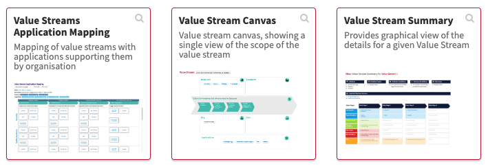
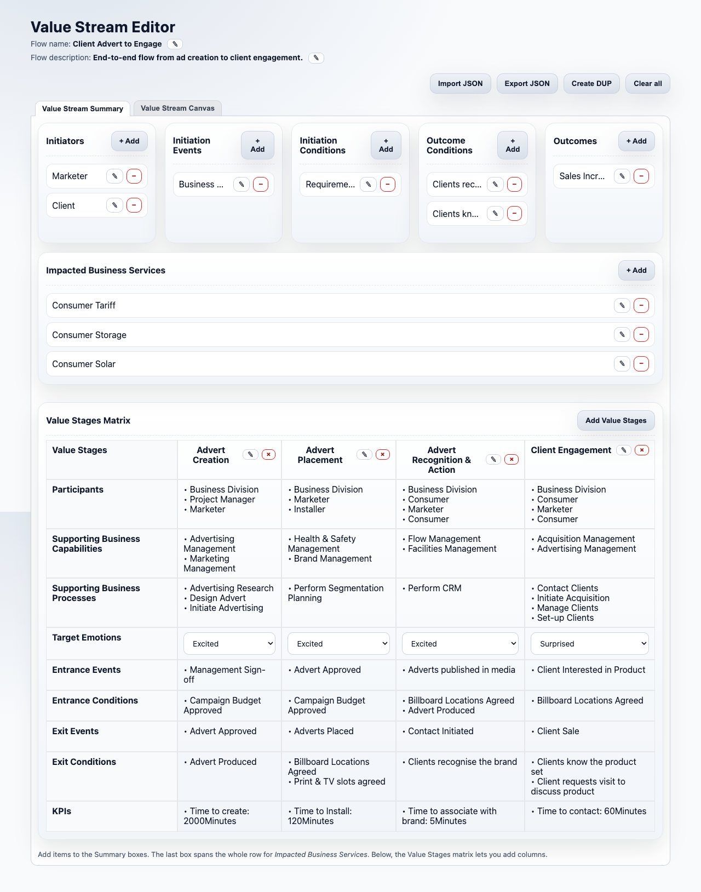
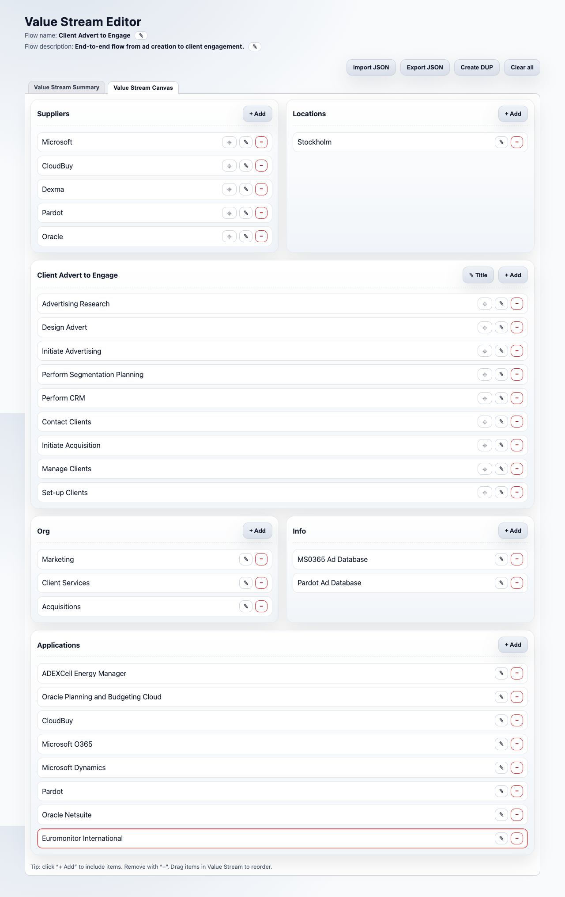
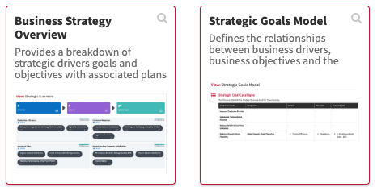
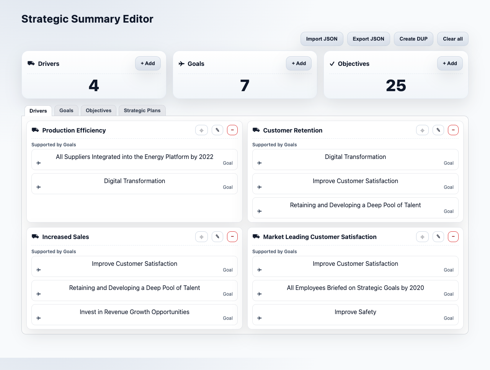
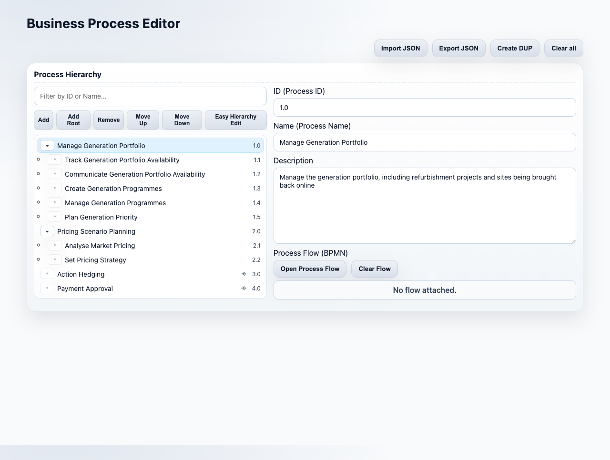
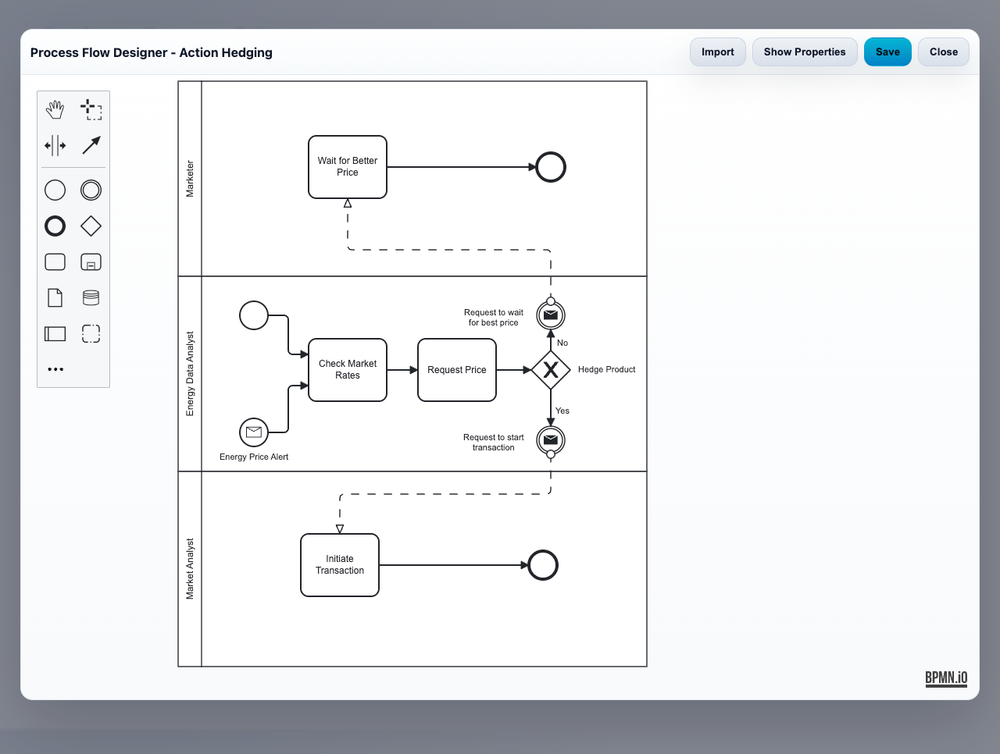
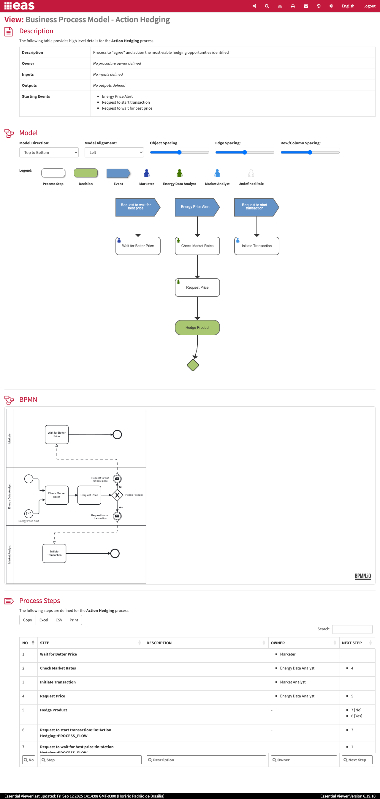
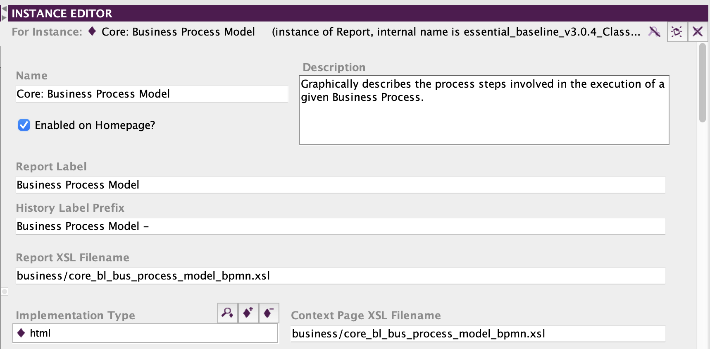
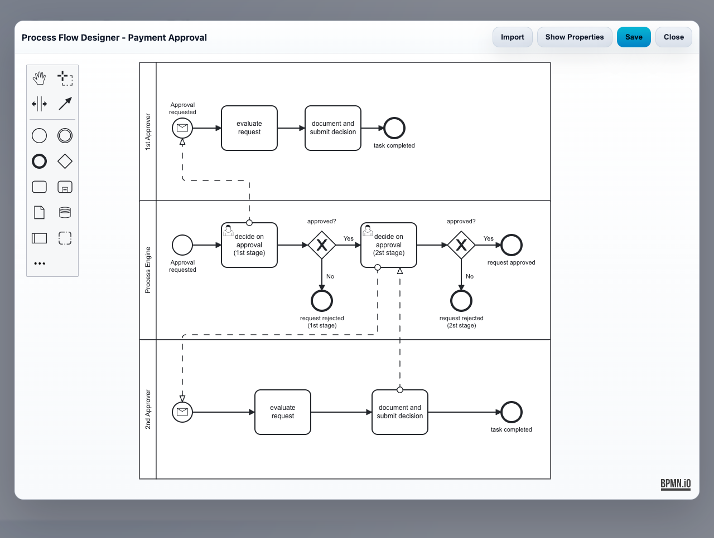

# Essential Open One Page Editor

HTML **standalone** pages acting as simple editors for collecting data for the **Essential Project**. Each editor supports **JSON import/export** and **`.dup` export** compatible with **Essential Open Source**, **Docker**, and **Cloud**.

The single-page approach is intentional: it provides a friendlier, simpler experience than spreadsheets. IT and business users can capture information quickly without dealing with workbook structures or formulas. The data for each Value Stream can be stored temporarily as **JSON** files for later validation by the architecture team and, once approved, exported as a **`.dup`** for import into Essential.

> ⚠️ **No integrity validation**: editors do not check consistency against the Essential repository; items with the same name already registered in Essential will be matched/related during `.dup` import. These single-page editors work directly with the information presented in the views; complementary details can be added later in Essential using **Protégé** (Open Source) or the **web editor** available in the Docker and Cloud versions.

## Status

- ✅ Available editor: **Value Stream Editor** (`editors/value-stream-editor-en-standalone.html`)
- ✅ Available editor: **Strategic Summary Editor** (`editors/strategic-summary-editor-en-standalone.html`)
- ✅ Available editor: **Business Process Editor (BPMN2)** (`editors/business-process-editor-en-standalone.html`)
- 🧩 Next: additional editors (capabilities, apps, etc.)

## Quick Start

1. Clone the repo.
2. Open one of the editors in a modern browser (Chrome/Edge/Firefox):
   - Value Streams: `editors/value-stream-editor-en-standalone.html`
   - Strategic Summary (Drivers/Goals/Objectives/Plans): `editors/strategic-summary-editor-en-standalone.html`
   - Business Processes (BPMN2): `editors/business-process-editor-en-standalone.html`
3. Fill in the data, then use **Export JSON** or **Create DUP**.
4. Import the `.dup` into Essential (Open/Docker/Cloud).

## What It’s For

This project reduces the learning curve for newcomers to Essential’s metamodel by providing a simple UI to capture data. Users (IT or business) can save **JSON** drafts for review by the architecture team and later generate a **`.dup`** for import into Essential.

### Value Stream Editor scope

The Value Stream Editor allows you to capture the information presented in the following Essential views:

- **Value Stream Summary**
- **Value Stream Canvas**
- **Value Streams Application Mapping**

#### Screenshots

### Strategic Summary Editor scope

The Strategic Summary Editor allows you to capture the information presented in the following Essential views:

- **Business Strategy Overview**
- **Strategic Goals Model**

#### Screenshots

## Business Process Editor (BPMN2)

The Business Process Editor lets you register processes in a simple hierarchy (ID, Name, Description) and attach a BPMN2 process flow using an embedded modeler.

File: `editors/business-process-editor-en-standalone.html`

The “Action Hedging” process was modeled in BPMN2 as an example (you can import it from `examples/business-process-template.json` for testing):

Important notes:

- For now, the BPMN2 diagram is saved entirely within a single `Diagram` instance. Edits made directly to diagram elements in Essential after importing the `.dup` will not be synchronized back to the diagram.
- I am not a BPMN expert. The BPMN2-to-Essential mapping below was created pragmatically and may need refinement. Contributions to validate and improve it are welcome. In the future, we can evolve to render the diagram in the view directly from the registered components.

Current mapping between BPMN2 components and Essential classes:

| BPMN2 Component                                               | Essential Class                     |
|---------------------------------------------------------------|-------------------------------------|
| `startEvent`, `intermediateThrowEvent`                        | `Start_Process_Flow`                |
| `timerEventDefinition`                                        | `Time_Based_Business_Event`         |
| `messageEventDefinition`                                      | `External_Business_Event`           |
| `conditionalEventDefinition`                                  | `Business_Event`                    |
| `exclusiveGateway`, `parallelGateway`, `complexGateway`       | `Business_Process_Flow_Decision`    |
| `endEvent`                                                    | `End_Process_Flow`                  |
| `sequenceFlow`, `MessageFlow`, `Association`                  | `:BPU-OCCURS_BEFORE-BPU`            |
| `task`, `userTask`, `manualTask`, `serviceTask`, `scriptTask`, `businessRuleTask`, `sendTask`, `receiveTask`, `dataObjectReference` | `Business_Activity` |

### Essential Report (BPMN in Business Process Flow)

The Essential report was adapted to display the BPMN diagram when opening “Business Process Flow”.

To enable it, set the fields “Report XSL Filename” and “Context Page XSL Filename” in Protégé as shown below:

### Examples

I also modeled a “Payment Approval” flow based on the examples from Camunda:

https://camunda.com/bpmn/examples/

## Repository Layout (high level)

- `editors/` — standalone HTML editors  
- `examples/` — sample JSON files (e.g., `value-stream-template.json`, `strategic-summary-template.json`, `business-process-template.json`)  
- `docs/` — guides and documentation  
- `assets/` — screenshots
